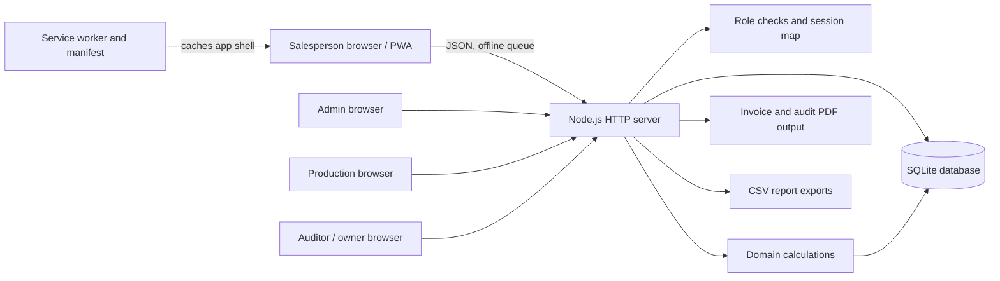
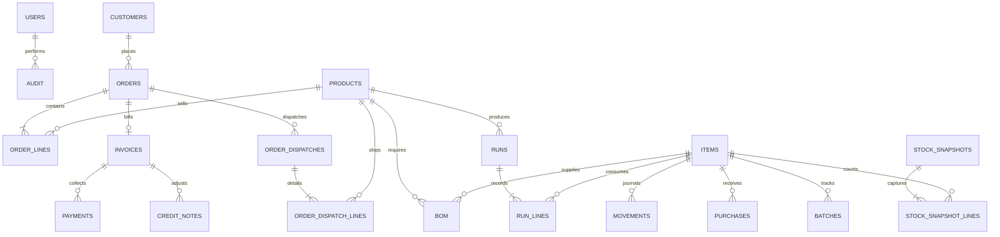

# System Architecture

## Overview

The prototype is a dependency-free Node.js web application backed by SQLite. A responsive browser client talks to JSON routes in the same HTTP server. The browser provides role-specific views and a service worker for offline order capture; the server owns validation, permissions, transactions, calculations, and audit records.

`server.js` contains the HTTP routes and browser application. `seed.js` creates or migrates the schema and inserts demo users and benchmark masters. `domain.js` contains stock, weighted-average costing, tax, variance, proportional credit-note, and unit-conversion functions. `domain.test.js` tests the arithmetic helpers. `start.js` runs the seed/migration step and starts the server. There are no third-party runtime packages.

## Transaction and data model

`products.stock_item_id` links each sellable SKU to its own finished-goods item in `items`. An order header identifies the customer, salesperson, and lifecycle status; `order_lines` records SKU, quantity, and the price-list price captured when submitted. Each line is checked against its product's finished-goods ledger before the invoice is posted. A dispatch can post all remaining quantity or a partial quantity; every shipped SKU creates its own negative movement.

Production runs reference a product and batch count. Expected output is `batch_yield × batch_count`. BOM quantities are stored per standard batch with their declared units. The server converts compatible units to the stock item's base unit, checks availability, then atomically records the run, planned/actual component lines, issues, output, and audit event. Variance is `(actual − planned) / planned`; yield and material variances beyond 3% are flagged.

## Stock, tax, and costing rules

The stock balance for an item is the sum of its movements. Opening balances, purchase receipts, production issues/output, dispatches, and accepted returns each have a source and reference in `movements`; code does not overwrite a running stock number. Batch receipts record code and expiry metadata. Manual stock snapshots preserve all item balances at the time they are taken; arbitrary past balances are not reconstructed unless a snapshot exists.

Amounts are stored in integer paise. Each material extension is rounded to paise before summing. GST is calculated at each product's configured rate, then split into CGST/SGST for Tamil Nadu customers or IGST for interstate customers. The exercise's seeded Murukku uses 5% GST. Production cost per good unit is consumed material cost plus run labour and utilities divided by good output. Material valuation uses the BOM rate, with flour's benchmark rate recalculated using moving weighted average after its purchase. The owner and production views compare cost with the pre-tax selling price to show margin per unit.

## Access, deployment, and boundaries

The API checks roles: salespeople access their own orders; admins manage masters, verify orders, invoice, dispatch, and collect payments; production records receipts and runs; auditors read reports and ledgers; owners see summary and reports. Offline orders are held in browser local storage and submitted on reconnect with a unique `client_ref` to prevent duplicate orders.

Run locally with `node start.js` on Node.js 22.5 or newer. Docker Compose is also included. Demo credentials are listed in the README.

This is an internship prototype, not a production accounting deployment: demo passwords are plain text, sessions are in memory, and deployment hardening is required. Batch receipts are traceable but are not allocated FEFO during consumption or dispatch. Finished-goods production output is not assigned a lot. Credit-note stock returns remain tailored to the seeded benchmark SKU. Tally sync, e-invoicing, and route tracking are outside scope.
